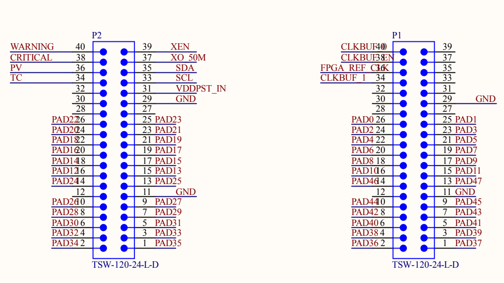

# PCB Jumper Array Layout

The chip's 48 pads break out to two TSW-120-24-L-D 2×20 jumper arrays on the PCB:

| Connector | PCB position           | Chip pads carried           | Direction (proposed)                    |
|-----------|------------------------|-----------------------------|-----------------------------------------|
| **P1**    | right edge of board    | PAD[0..11] + PAD[36..47]    | RX (downstream FPGA→ASIC) jumper        |
| **P2**    | left edge of board     | PAD[12..35]                 | TX (upstream ASIC→FPGA) jumper          |

```
                                     CHIP
                            ┌─────────────────────┐
                            │  TOP    PAD[0..11]  │
                            │                     │
              P2 (left,     │ LEFT          RIGHT │     P1 (right,
              TX jumper)    │ PAD[12..23]     PAD │     RX jumper)
              PAD[12..35]   │             [36..47]│     PAD[0..11]
                            │                     │     + PAD[36..47]
                            │  BOTTOM PAD[24..35] │
                            └─────────────────────┘
```



The chip-side PAD assignments below are organized so that **`dn_data[15:0]` lands on two 2×4 grids of P1** and **`up_data[15:0]` lands on two 2×4 grids of P2**, so each 16-bit data bus can plug into a pair of 2×4 sub-jumpers on the FPGA daughtercard. **All 3 DFT scan signals (`scan_en`, `scan_in`, `scan_out`) sit contiguously** in P1's middle section. SPI is also clustered in P2's middle section (one bit, `SS_n`, sits below the `GND` row to fit).

## P1 — RX jumper (top + right of chip)

Carries the chip's downstream-RX 16-bit DDR bus + bsg_link control + DFT scan + global control. Connects to the FPGA daughtercard's RX-side connector on the right edge of the PCB.

| Pin | Net (PCB)     | Chip signal     | Pin | Net (PCB)     | Chip signal     |
|----:|---------------|-----------------|----:|---------------|-----------------|
|  40 | `CLKBUF_40`   | —               |  39 | —             | —               |
|  38 | `CLKBUF_3`    | —               |  37 | `XEN`         | —               |
|  36 | `FPGA_REF_CLK`| —               |  35 | —             | —               |
|  34 | `CLKBUF_1`    | —               |  33 | —             | —               |
|  32 | —             | —               |  31 | —             | —               |
|  30 | —             | —               |  29 | `GND`         | —               |
|  28 | —             | —               |  27 | —             | —               |
|  26 | **`PAD0`**    | `dn_data[0]`    |  25 | **`PAD1`**    | `dn_data[1]`    | ← Grid 1: `dn_data[7:0]`
|  24 | **`PAD2`**    | `dn_data[2]`    |  23 | **`PAD3`**    | `dn_data[3]`    |
|  22 | **`PAD4`**    | `dn_data[4]`    |  21 | **`PAD5`**    | `dn_data[5]`    |
|  20 | **`PAD6`**    | `dn_data[6]`    |  19 | **`PAD7`**    | `dn_data[7]`    |
|  18 | **`PAD8`**    | `dn_clk`        |  17 | **`PAD9`**    | `dn_valid`      | ← bsg_link RX control
|  16 | **`PAD10`**   | `dn_token`      |  15 | **`PAD11`**   | `scan_en`       |
|  14 | **`PAD46`**   | `scan_in`       |  13 | **`PAD47`**   | `scan_out`      | ← DFT scan trio
|  12 | —             | —               |  11 | `GND`         | —               |
|  10 | **`PAD44`**   | `core_clk`      |   9 | **`PAD45`**   | `hard_reset`    | ← board control
|   8 | **`PAD42`**   | `dn_data[15]`   |   7 | **`PAD43`**   | `dn_data[14]`   | ← Grid 2: `dn_data[15:8]`
|   6 | **`PAD40`**   | `dn_data[13]`   |   5 | **`PAD41`**   | `dn_data[12]`   |
|   4 | **`PAD38`**   | `dn_data[11]`   |   3 | **`PAD39`**   | `dn_data[10]`   |
|   2 | **`PAD36`**   | `dn_data[9]`    |   1 | **`PAD37`**   | `dn_data[8]`    |

**Grid 1 (`dn_data[7:0]`)**: P1 pins 19–26 form a 2×4 block (4 pin-pairs).  
**Grid 2 (`dn_data[15:8]`)**: P1 pins 1–8 form another 2×4 block.  
The bsg_link RX control + DFT scan trio + global control fill the gap between the two grids and the GND row. Non-PAD pins above pin 26 are board-level reference clocks and signals routed elsewhere on the PCB.

## P2 — TX jumper (left + bottom of chip)

Carries the chip's upstream-TX 16-bit DDR bus + bsg_link TX control + SPI + BLE modulator output. Connects to the FPGA daughtercard's TX-side connector on the left edge of the PCB.

| Pin | Net (PCB)     | Chip signal     | Pin | Net (PCB)     | Chip signal     |
|----:|---------------|-----------------|----:|---------------|-----------------|
|  40 | `WARNING`     | —               |  39 | `XEN`         | —               |
|  38 | `CRITICAL`    | —               |  37 | `XO_50M`      | —               |
|  36 | `PV`          | —               |  35 | `SDA`         | —               |
|  34 | `TC`          | —               |  33 | `SCL`         | —               |
|  32 | —             | —               |  31 | `VDDPST_IN`   | —               |
|  30 | —             | —               |  29 | `GND`         | —               |
|  28 | —             | —               |  27 | —             | —               |
|  26 | **`PAD22`**   | `up_data[0]`    |  25 | **`PAD23`**   | `up_data[1]`    | ← Grid 3: `up_data[7:0]`
|  24 | **`PAD20`**   | `up_data[2]`    |  23 | **`PAD21`**   | `up_data[3]`    |
|  22 | **`PAD18`**   | `up_data[4]`    |  21 | **`PAD19`**   | `up_data[5]`    |
|  20 | **`PAD16`**   | `up_data[6]`    |  19 | **`PAD17`**   | `up_data[7]`    |
|  18 | **`PAD14`**   | `up_valid`      |  17 | **`PAD15`**   | `up_clk`        | ← bsg_link TX control
|  16 | **`PAD12`**   | `token_clk`     |  15 | **`PAD13`**   | `SCLK`          |
|  14 | **`PAD24`**   | `MOSI`          |  13 | **`PAD25`**   | `MISO`          | ← SPI (3 of 4)
|  12 | —             | —               |  11 | `GND`         | —               |
|  10 | **`PAD26`**   | `SS_n`          |   9 | **`PAD27`**   | `PIN_18` (BLE)  | ← SPI tail + BLE
|   8 | **`PAD28`**   | `up_data[8]`    |   7 | **`PAD29`**   | `up_data[9]`    | ← Grid 4: `up_data[15:8]`
|   6 | **`PAD30`**   | `up_data[10]`   |   5 | **`PAD31`**   | `up_data[11]`   |
|   4 | **`PAD32`**   | `up_data[12]`   |   3 | **`PAD33`**   | `up_data[13]`   |
|   2 | **`PAD34`**   | `up_data[14]`   |   1 | **`PAD35`**   | `up_data[15]`   |

**Grid 3 (`up_data[7:0]`)**: P2 pins 19–26 form a 2×4 block.  
**Grid 4 (`up_data[15:8]`)**: P2 pins 1–8 form another 2×4 block.  
SPI's `SS_n` sits just below the GND row on P2 pin 10 because only 6 slots fit between the top grid and the GND row, and the 3 bsg_link TX control signals + 3 of 4 SPI signals need them. `PIN_18` is its neighbor on pin 9.

## Chip-side proposed pad function map

48 IO pads, 12 per side. Each side has a power/ground (PG) strip splitting it into two banks of 6.

### TOP — PAD[0..11] → P1 (RX jumper, dn_data byte 0 + bsg control)

| PAD | Function          | Direction   |
|----:|-------------------|-------------|
|   0 | `dn_data[0]`      | in          |
|   1 | `dn_data[1]`      | in          |
|   2 | `dn_data[2]`      | in          |
|   3 | `dn_data[3]`      | in          |
|   4 | `dn_data[4]`      | in          |
|   5 | `dn_data[5]`      | in          |
| —— *PG strip* —— |||
|   6 | `dn_data[6]`      | in          |
|   7 | `dn_data[7]`      | in          |
|   8 | `dn_clk`          | in          |
|   9 | `dn_valid`        | in          |
|  10 | `dn_token`        | out         |
|  11 | `scan_en`         | in (DFT)    |

### LEFT — PAD[12..23] → P2 (TX jumper, control + up_data byte 0 partial)

| PAD | Function          | Direction   |
|----:|-------------------|-------------|
|  12 | `token_clk`       | in          |
|  13 | `SCLK`            | in (SPI)    |
|  14 | `up_valid`        | out         |
|  15 | `up_clk`          | out         |
|  16 | `up_data[6]`      | out         |
|  17 | `up_data[7]`      | out         |
| —— *PG strip* —— |||
|  18 | `up_data[4]`      | out         |
|  19 | `up_data[5]`      | out         |
|  20 | `up_data[2]`      | out         |
|  21 | `up_data[3]`      | out         |
|  22 | `up_data[0]`      | out         |
|  23 | `up_data[1]`      | out         |

### BOTTOM — PAD[24..35] → P2 (TX jumper, SPI + up_data byte 1)

| PAD | Function          | Direction   |
|----:|-------------------|-------------|
|  24 | `MOSI`            | in (SPI)    |
|  25 | `MISO`            | out (SPI)   |
|  26 | `SS_n`            | in (SPI)    |
|  27 | `PIN_18` (BLE)    | out         |
|  28 | `up_data[8]`      | out         |
|  29 | `up_data[9]`      | out         |
| —— *PG strip* —— |||
|  30 | `up_data[10]`     | out         |
|  31 | `up_data[11]`     | out         |
|  32 | `up_data[12]`     | out         |
|  33 | `up_data[13]`     | out         |
|  34 | `up_data[14]`     | out         |
|  35 | `up_data[15]`     | out         |

### RIGHT — PAD[36..47] → P1 (RX jumper, dn_data byte 1 + control)

| PAD | Function          | Direction   |
|----:|-------------------|-------------|
|  36 | `dn_data[9]`      | in          |
|  37 | `dn_data[8]`      | in          |
|  38 | `dn_data[11]`     | in          |
|  39 | `dn_data[10]`     | in          |
|  40 | `dn_data[13]`     | in          |
|  41 | `dn_data[12]`     | in          |
| —— *PG strip* —— |||
|  42 | `dn_data[15]`     | in          |
|  43 | `dn_data[14]`     | in          |
|  44 | `core_clk`        | in          |
|  45 | `hard_reset`      | in          |
|  46 | `scan_in`         | in (DFT)    |
|  47 | `scan_out`        | out (DFT)   |

The bit-to-PAD ordering inside each `dn_data` / `up_data` byte is dictated by how the PCB schematic maps connector pins to chip pads (e.g. `dn_data[8]` lands on PAD[37] because P1 pin 1 routes to PAD[37]). The `chip_top.sv` wrapper just enumerates each bit's PAD index explicitly — no on-chip cost.

## Function summary

| Block                                                                  | Pads used                       | Count |
|------------------------------------------------------------------------|---------------------------------|------:|
| Core: `core_clk`, `hard_reset`                                         | 44, 45                          |     2 |
| RX (downstream): `dn_clk`, `dn_valid`, `dn_data[15:0]`, `dn_token`     | 8, 9, 0..7 + 36..43, 10         |    19 |
| TX clocks: `token_clk`, `up_clk`                                       | 12, 15                          |     2 |
| TX (upstream): `up_valid`, `up_data[15:0]`                             | 14, 16..23 + 28..35             |    17 |
| SPI: `SCLK`, `MOSI`, `MISO`, `SS_n`                                    | 13, 24, 25, 26                  |     4 |
| BLE modulator: `PIN_18`                                                | 27                              |     1 |
| DFT scan: `scan_en`, `scan_in`, `scan_out` *(all together)*            | 11, 46, 47                      |     3 |
| **Total**                                                              |                                 |  **48** |

`io_master_clk` (TX-domain master clock for `bsg_link_ddr_upstream`) is **not pinned out**; it is tied internally to `core_clk` to save one pad.

## Async clock domains for SDC

With `io_master_clk = core_clk`, the chip top has 3 mutually-async clock domains, all declared as separate `create_clock`s in `cfg/constraints.tcl` and grouped via `set_clock_groups -asynchronous`:

| Clock        | Source                                    | Used by                                |
|--------------|-------------------------------------------|----------------------------------------|
| `core_clk`   | local (PAD[44])                           | core logic, `bsg_link_ddr_upstream` core side |
| `dn_clk`     | received from FPGA (PAD[8])               | `bsg_link_ddr_downstream` IO side      |
| `token_clk`  | received from FPGA (PAD[12])              | `bsg_link_ddr_upstream` token side     |

`token_clk` is declared async to `core_clk` because it returns from the FPGA after a board+FPGA round-trip with unknown propagation delay (same reason a DDR memory's read DQS strobe is async to its source-clock at the controller).

## Cluster contiguity

- **`dn_data[7:0]`** → P1 pins 19–26 (one 2×4 grid). On chip: PAD[0..7], all on the top side bank-1+bank-2 — fully contiguous on chip too.
- **`dn_data[15:8]`** → P1 pins 1–8 (second 2×4 grid). On chip: PAD[36..43], on the right side bank-1 + start of bank-2 — fully contiguous on chip.
- **`up_data[7:0]`** → P2 pins 19–26 (one 2×4 grid). On chip: PAD[16..23], all on the left side.
- **`up_data[15:8]`** → P2 pins 1–8 (second 2×4 grid). On chip: PAD[28..35], all on the bottom side bank-1+bank-2.
- **DFT scan trio** → contiguous on chip PADs[11, 46, 47] *and* on P1 pins 13–15 — all three signals on the same connector, adjacent.
- **bsg_link RX control** (`dn_clk`, `dn_valid`, `dn_token`) → contiguous on PAD[8..10], P1 pins 16–18.
- **bsg_link TX control** (`token_clk`, `up_clk`, `up_valid`) → on PAD[12, 14, 15], P2 pins 16–18 (with `SCLK` interleaved on PAD[13]/P2 pin 15).
- **SPI** (`SCLK`, `MOSI`, `MISO`, `SS_n`) → mostly contiguous: SCLK/MOSI/MISO on PAD[13, 24, 25] (P2 pins 13–15), `SS_n` is one pin past the GND row on PAD[26]/P2 pin 10. Splitting one SPI bit across the GND row is what makes the rest of the layout (2×4 grids + scan trio together + bsg control grouped) all fit in 48 pads.
